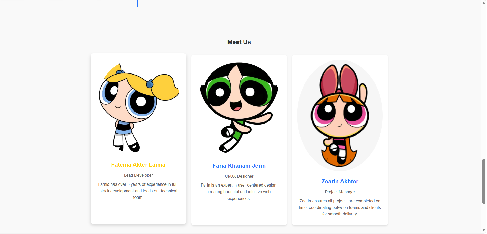

# Trio Trouble – Portfolio Website

Responsive portfolio website for **Trio Trouble**, a three-member web solutions team, with services, projects, an achievements timeline, a contact form and light/dark mode. Built with HTML, CSS and vanilla JavaScript.

> Course project for **CSE-256: Web Application Development** at UITS (University of Information Technology and Sciences).

## Screenshot

<!-- Add a screenshot of the homepage: save it as images/screenshot.png and it will show here -->


## Features

- **Responsive layout** that adapts to desktop, tablet and mobile screens
- **Smooth scrolling** navigation between sections
- **Light/Dark mode** toggle
- **Services and Projects** shown as animated cards
- **Achievements timeline** with scroll-triggered animation
- **Team section** introducing each member
- **Contact form** with input validation
- **Font Awesome icons** throughout the page

## Tech Stack

| Technology | Purpose |
|---|---|
| HTML5 | Page structure |
| CSS3 | Styling, grid layout, animations, media queries |
| JavaScript (ES6) | Interactivity: scrolling, theme toggle, form, timeline animation |
| Font Awesome 6 | Icons |

## Project Structure

```
├── index.html    # Main page
├── index.css     # Styles
├── index.js      # Scripts
└── images/       # Project and team images
```

## How to Run

1. Clone the repository:
   ```bash
   git clone https://github.com/Zearin14/Zearin_CSE-256_WAD_Portfolio_Website-Trio.git
   ```
2. Open `index.html` in any web browser.

No installation or build step is needed.

## Team

| Name | Role |
|---|---|
| Fatema Akter Lamia | Lead Developer |
| Faria Khanam Jerin | UI/UX Designer |
| Zearin Akhter | Project Manager |
